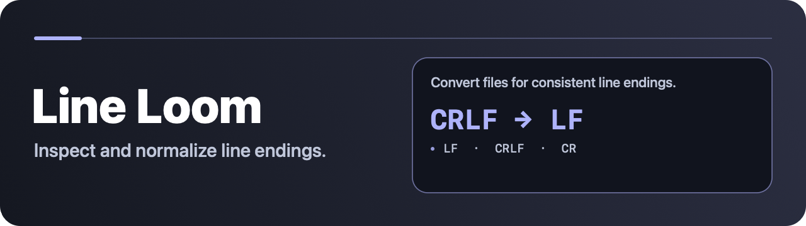

<p align="center">
  
</p>

# Line Loom

See whether a UTF-8 text file mixes Unix, Windows, or classic Mac line endings. Convert it when you need a consistent format.

## At a glance

| Task | How |
| --- | --- |
| **Inspect a file** | Pass a UTF-8 file to count LF, CRLF, and CR endings. |
| **Normalize line endings** | Use `--to lf` or `--to crlf` with `-o`. |
| **Keep the source** | Write the converted text to a new path. |

## Quick start

```sh
python3 line_loom.py notes.txt
python3 line_loom.py notes.txt --to lf -o notes-clean.txt
```

Requires Python 3.8+. Conversion preserves the UTF-8 BOM and the presence or absence of a final line ending. The destination must be a new file. [MIT](LICENSE)

## Development

Run the same dependency-free regression tests used in GitHub Actions.

```sh
python3 -m unittest discover -s tests -v
```
